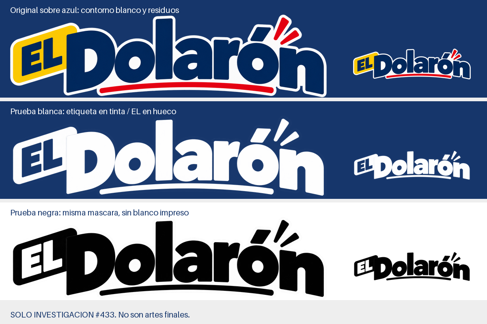

# Marca de El Dolarón — investigación de la fase 1 (#433)

22/10/2026. **Recomendación: conservar los tres originales a color y añadir solamente un horizontal negro y uno blanco, derivados de sus píxeles.** Para `/vender`, usar el blanco transparente sobre azul. No producir todavía una familia de SVG ni versiones para aplicaciones sin pedido real.

## Alcance y evidencia

Revisión del árbol versionado en `2d82fad` y de `origin/agent/codex/431-vender` local en `8b96533179a01d4cdffc7f86074b2fe28f606aef`; no se actualizó esa referencia remota. Se leyeron `AGENTS.md`, `README.md`, paleta, textos, inventario, `site/DESIGN.md` y `docs/MARKETING-30-DIAS.md`; se buscaron referencias a logos, imágenes y colores en el resto del árbol, sin leer `.dev.vars` ni `.env*`. Se inspeccionaron visualmente los tres originales y las piezas raster del kit. De `EMPIEZA-AQUI.html` solo se extrajeron coincidencias acotadas, nunca su contenido completo.

Esto documenta **usos presentes en archivos**, no demuestra que cada pieza esté publicada o cada integración desplegada. El marketing contiene observaciones de septiembre y propuestas: no convierte sus datos en vigentes. La frase sobre SVG e insignias en su sección 8 quedó desactualizada; `01-Logos/`, el inventario y `site/DESIGN.md` establecen el logo vigente del 7/10. No rescatar el símbolo D ni la insignia circular retirados.

## 1. Inventario de usos

Las medidas son píxeles de archivo/lienzo salvo que se indique CSS, mm o puntos de impresión. En PNG planos el logo está integrado, sin instancia editable ni medida independiente declarada. “Color” significa que no es arte de una tinta.

### Kit y archivos maestros

| Ruta | Uso y tamaño | Fondo / tinta |
| --- | --- | --- |
| `01-Logos/el-dolaron-logo.png` | Maestro horizontal, 2056×537 | Transparente; contorno blanco propio; color |
| `01-Logos/el-dolaron-logo-vertical.png` | Maestro vertical, 1711×996; avatares y cuadrados | Transparente; contorno blanco; color |
| `01-Logos/el-dolaron-icono-el.png` | Etiqueta «EL», 414×396; tamaños pequeños | Transparente; etiqueta amarilla, letras azules, borde blanco; color |
| `02-Perfiles-y-portadas/el-dolaron-perfil-cuadrado.png` | Avatar común FB/IG/TikTok/WhatsApp, 1254×1254; logo vertical | Blanco, recorte circular previsto; color |
| `02-Perfiles-y-portadas/el-dolaron-portada-horizontal.png` | Portada con logo horizontal y franjas, 2172×724 | Blanco; azul, rojo y amarillo; color |
| `03-Publicaciones/el-dolaron-bienvenida-4x5.png` | Bienvenida, 1122×1402; logo superior | Blanco; titulares azules, etiqueta amarilla, franjas rojas; color |
| `03-Publicaciones/el-dolaron-producto-4x5.png` | Producto, 1122×1402; logo superior | Blanco, precio amarillo, pie azul/rojo; color |
| `03-Publicaciones/el-dolaron-novedades-4x5.png` | Cuatro productos, 1122×1402; logo superior | Blanco, marcos azules y bandas amarillas, franjas rojas; color |
| `03-Publicaciones/el-dolaron-cierre-redes-cuadrado.png` | Cierre/contactos, 1254×1254 | Azul, logo sobre papel blanco irregular; amarillo/rojo; color |
| `04-Historias/el-dolaron-producto-historia-9x16.png` | Historia/portada de video, 941×1672 | Blanco, logo arriba, etiqueta amarilla, acentos rojos/azules; color |
| `04-Historias/el-dolaron-aviso-historia-9x16.png` | Aviso, 940×1672 | Blanco, logo arriba, franjas rojas y etiqueta amarilla lateral; color |
| `EMPIEZA-AQUI.html` | Guía/preview; imágenes base64, enlaces a los tres originales y las piezas | Interfaz clara, muestras de los cuatro colores; no arte de impresión |
| `Codex Image Sep 10, 2026, 12_30_01 AM.png` | Composición histórica, 1774×887, logo y elementos estadounidenses/marcas de terceros | Blanco/ilustración; color. Sin consumidor encontrado ni entrada en inventario; no recomendar como maestro |

El inventario describe el cierre como “opaque white”, pero visualmente predomina azul y solo el soporte del logo es blanco. Es metadato a corregir en fase 2, no evidencia de una variante nueva. El mismo cierre existe en `app/public/marketplace-redes.png`.

### Sitio, portal y tarjetas compartidas

| Ruta / consumidor | Tamaño y función | Fondo / tinta |
| --- | --- | --- |
| `site/public/assets/el-dolaron-logo.png` → `site/public/index.html`, `que-es-un-saldo.html` | Archivo 900×235; cabecera CSS 222/150/124 px según ancho, pie 160 px; `index.html` también lo declara en JSON-LD | Blanco con sombra CSS azul; color |
| Mismo PNG → `site/public/politica-de-privacidad.html` | Cabecera CSS 220/170 px; vista de impresión del navegador mantiene la imagen | Blanco; color, sin separación especial para una tinta |
| `site/public/assets/el-dolaron-logo-vertical.png` → `index.html` | 500×291; CSS 300 o 220 px, oculto en pantallas menores | Sección Dolarones amarilla, sombra azul; color |
| `site/public/assets/favicon.png` | «EL», 64×64, declarado en `index.html` y `que-es-un-saldo.html`; tamaño final del navegador variable | Transparente, pestaña clara u oscura; color |
| `site/public/assets/apple-touch-icon.png` | «EL», 180×180; mismos HTML | Azul opaco; color |
| `site/compartir-fuente.html` → `site/public/assets/el-dolaron-compartir-v3.jpg` | Fuente de captura 1200×630; logo CSS 300 px. OG/Twitter en `index.html` y `que-es-un-saldo.html`; guía de regeneración en `site/README.md` | Logo sobre blanco; titular azul/rojo, cinta amarilla, pie azul; color |
| `app/public/el-dolaron-logo.png` → `portal.html` + `portal.css` | 600×156; logo CSS 150 px. Ruta pública permitida en `app/src/worker.ts` | Cabecera blanca; tarjetas del programa azul/amarillo/blanco; color |
| `app/public/marketplace.html` → `marketplace-redes.png` | Descarga opcional de cierre 1254×1254. Las fotos de producto se descargan aparte, no se les estampa logo | Cierre azul con papel blanco para el logo; color |
| Rama #431: `app/public/vender.html` / `vender.js`, `crearTarjeta` | Pantalla sin imagen de logo; salida JPEG 1080×1350, logo contenido en 390×76 (efectivo ≈292×76 por proporción) | Foto sobre blanco; franja azul de y=1000 a 1350, precio amarillo y textos blancos; actualmente rectángulo blanco 420×92 bajo el logo; color |

Evidencia principal: [estilos del sitio](../../site/public/styles.css), [fuente OG](../../site/compartir-fuente.html), [portal](../../app/public/portal.css), [Marketplace](../../app/public/marketplace.html) y [`crearTarjeta` en el commit revisado](https://github.com/iskaar/El-Dolaron-Social-Kit/blob/8b96533179a01d4cdffc7f86074b2fe28f606aef/app/public/vender.js#L58).

### Caja, operación e impresión

**No hay una imagen de logo en la caja ni en estas pantallas operativas.** Se usa el nombre como texto y la paleta como interfaz. El tamaño del logo es “no aplica”; los tamaños de texto son adaptables por pantalla. Todas son de color salvo las salidas impresas indicadas abajo. Esta agrupación enumera los archivos consumidores de colores; no supone que todos empleen los cuatro.

| Rutas bajo `app/public/` | Para qué y sobre qué fondo |
| --- | --- |
| `index.html`, `sin-acceso.html` | Menú/acceso: cabecera azul, letras blancas; paneles blancos sobre gris claro, botones azules, avisos rojos |
| `caja.html`, `cajero.js`, `ticket.js` | Cobro, selector de cajero, consulta de tickets: azul/blanco; enlaces amarillos y avisos rojos; diálogo de cajero sobre azul |
| `admin.html`, `conteo.html`, `cuentas.html`, `escanear.html`, `pedidos.html`, `socios.html`, `mensajes.html`, `mercadolibre.html`, `gastos.html`, `nomina.html` | Inventario, personal, escaneo, pedidos, socios, mensajes, ML y administración: azul para cabeceras/acciones sobre paneles blancos/gris; rojo para errores/estados, amarillo donde se declara para enlaces/acciones |
| `bandas.html`, `codigos.html`, `etiquetas.html`, `calibrar-etiqueta.html`, `prueba-codigo.html`, `sonda-impresora.html` | Operación de etiquetas y diagnóstico; cabeceras azules con enlaces amarillos sobre paneles claros. `codigos.html` usa rojo oscuro `#B3141B`, no el rojo primario |
| `captura.html` | Cámara a pantalla completa sobre negro/foto; amarillo en contadores, rojo en errores, azul declarado como token; sin marca sobre la foto guardada |
| `reportes.html` | Analítica sin logo: marca azul y amarillo; superficies claras u oscuras según tema; series y estados tienen su propia paleta funcional |
| `tarjeta-bandas.html` | Hoja de consulta imprimible tamaño carta, margen 12 mm; nombre y precios azules sobre blanco, sin logo. El CSS de impresión oculta cabecera; no fuerza monocromo: depende de impresora/driver |
| `impresora.js` | Epson TM-T20 II, papel 80 mm, 48 columnas: ticket y vale con `EL DOLARON` como texto grande. **Negro sobre papel, una tinta, sin logo raster**, retirado por bloqueos de impresión (#97) |
| `etiquetera.js` | AE240 BT, TSPL, 203 dpi, 50.8×25.4 mm ≈406×203 puntos; nombre/precio/barras/pie, márgenes laterales 16 puntos |

La última fila también es **negro sobre etiqueta blanca, una tinta y sin logo**; no hay comando BITMAP de marca en `tsplEtiqueta` ni `tsplBanda`. La cabecera de la pantalla `/etiquetas` no se imprime. Los experimentos no autorizan añadir un logo a estas etiquetas ni reactivar imágenes en la Epson. Véanse [ticket, comentario de #97](../../app/public/impresora.js#L267) y [generación TSPL](../../app/public/etiquetera.js#L187).

Fuera de `public/`, `app/src/worker.ts:121` inyecta la franja roja `#D72B32` con texto blanco del sandbox. `app/src/cuentas.ts` y `worker.ts` permiten/enrutan los PNG ya enumerados; no son nuevos diseños. `app/public/compartir.js` convierte/copia fotos, sin logo ni paleta añadidos.

### Mercado Libre, Meta y otros soportes

- **Mercado Libre:** `app/public/mercadolibre.html` usa la interfaz azul/amarillo/rojo. `app/src/mercadolibre.ts:805–848` envía la foto de la pieza desde almacenamiento o usa la ficha de catálogo ML; no añade logo, cierre ni tarjeta comercial. Tamaño variable del producto, fondo de su foto/catálogo, color. No hace falta variante de logo para esas fotos: la [guía oficial de fotos de accesorios](https://vendedores.mercadolibre.com.mx/nota/requisitos-de-fotos-para-vender-accesorios?suScope=prod) indica no agregar logos, marcas de agua, bordes, QR ni textos. Comprobar la guía de cada categoría antes de publicar; no trasladar la tarjeta WhatsApp a ML.
- **Meta:** avatares, portada, posts, historias y cierre son los usos del kit enumerados; WhatsApp/Facebook también reciben la vista OG del sitio. `app/src/mensajes.ts:93` usa Graph API para respuestas **de texto**, sin arte de marca. No se encontró publicador de anuncios ni feed de productos Meta con un logo propio. No se auditó la configuración actual de cuentas. La ayuda de [Meta sobre avatar/portada](https://www.facebook.com/help/125379114252045) redirigió a login; no se presentan tamaños externos actuales como comprobados. Mantener medidas del kit y revisar recortes en el canal real.
- **Fotos:** no se encontró un consumidor que requiera marca directamente sobre fotografía de producto. Si un futuro diseño lo necesita, buscar una zona tranquila con contraste o reservar un soporte; no fabricar una familia de logos “para foto”.
- **Sellos, bolsas, uniformes, grabado, letrero:** mencionados como posibilidades en #433; no hay artes, tamaños, proveedor ni pedido confirmado en el árbol. El plan de marketing propone grabar la fachada, no encarga su rotulación. Una tinta negra deja preparado un recurso básico, pero estas posibilidades no justifican aún otras versiones ni mínimos industriales.

Las fuentes de reglas son [Paleta.json](../../05-Guia-y-textos/Paleta.json), [site/DESIGN.md](../../site/DESIGN.md), [Textos-para-redes.txt](../../05-Guia-y-textos/Textos-para-redes.txt), [inventario](../../05-Guia-y-textos/Inventario-de-archivos.json) y [marketing](../MARKETING-30-DIAS.md): documentan o gobiernan usos, no son aplicaciones adicionales del logo.

## 2. Píxeles oficiales y método de producción

Los PNG son RGBA planos; “capas” significa **máscaras inferidas por color**, no capas recuperadas del diseñador. La medición se hizo con Pillow sobre los tres originales, inspeccionados como imagen. Datos completos, hashes y algoritmo: [mediciones.json](pruebas/mediciones.json) y [probar_png.py](pruebas/probar_png.py).

| Original | Tamaño | Alfa 0 | Alfa 1–254 | Alfa 255 |
| --- | --- | ---: | ---: | ---: |
| Horizontal | 2056×537 | 344006 | 757020 | 3046 |
| Vertical | 1711×996 | 788300 | 907794 | 8062 |
| «EL» | 414×396 | 39839 | 123443 | 662 |

En el horizontal, entre píxeles de alfa ≥128, las modas de familia son azul **#01285C** (40250 píxeles), rojo **#E70112** (4001), amarillo **#FDCA01** (6630) y casi blanco **#FDFDFD** (50769). En los tres originales hay **cero coincidencias exactas** de azul, rojo y amarillo con los HEX de Paleta.json en ese rango de alfa. La paleta ya advierte que sus valores son objetivos para composiciones nuevas: no “corregir” masivamente las piezas existentes ni cambiar esos objetivos para igualar un render.

Predominan alfas 253/254 incluso en interiores; contar solo alfa 255 daría una lectura falsa de sus colores. Hay antialias en curvas y transiciones, variación interna de RGB y un contorno blanco que también ocupa los ojos de las letras. El bbox de alfa toca los cuatro bordes de cada archivo: no existe una zona de protección incorporada fiable. Se observan residuos irregulares alrededor del contorno, especialmente bajo la etiqueta/subrayado del horizontal y en uniones del vertical. A alfa ≥128 el vertical tiene 12 islas diminutas (20 píxeles en total); horizontal e ícono forman una sola componente: buena parte del ruido está conectado al borde o tiene menor alfa. Eliminar solamente islas no lo soluciona.

| Opción | Calidad y límites | Esfuerzo / riesgo |
| --- | --- | --- |
| **A. Máscaras con Python/PIL, recomendada ahora** | Conserva coordenadas y proporciones. Separa azul/rojo/amarillo del blanco, reconstruye cobertura en transiciones y recolorea; deja el blanco sin tinta en monocromo. No recupera curvas ideales; puede conservar halos y textura. Exportar PNG transparente y reducir una sola vez al destino | Bajo, unas horas de preparación/revisión para horizontales. Pillow ya está instalado; sin dependencia nueva del proyecto. Riesgo medio en píxeles de mezcla y etiqueta superpuesta: revisar máscaras y muestras al tamaño final |
| **B. Calco a SVG desde máscaras, Potrace/Inkscape** | Puede dar curvas escalables y contornos manejables para corte. El calco aproxima la fuente: puede copiar ruido o borrar esquinas, huecos, acento y subrayado al suavizar. A 203 dpi el resultado igualmente termina en puntos; SVG no garantiza mejor lectura | Medio, al menos una sesión de comparación y correcciones de parámetros. Potrace tiene ZIP oficial Windows 64 bits, extraíble una vez fuera del repo; Inkscape integra el calco. No instalados para esta prueba. Revisar contra el PNG superpuesto antes de aceptar; no editar nodos a gusto |
| **C. Recuperar archivo nativo del autor** | Mejor opción si existe SVG/AI/PDF realmente vectorial de este mismo logo: elimina la incertidumbre de segmentación sin redibujar. Un SVG que solo incrusta el PNG no mejora bordes | Búsqueda de duración desconocida; no consta tal archivo en el repo. No bloquear las variantes raster esperando que aparezca |

Potrace acepta PBM/PGM/BMP y exporta SVG; flujo propuesto: generar una máscara PBM por región desde PIL, ejecutar por ejemplo `potrace mascara.pbm -s -o mascara.svg -t 0 -a 0 -O 0`, alinear todas con el mismo lienzo y asignar rellenos. Es un punto de partida conservador **no probado**, no una garantía de geometría idéntica; aumentar suavizado solo tras comparar diferencias. El parámetro `-t` elimina motas y `-O` controla tolerancia. Fuentes: [Potrace, descarga y opciones oficiales](https://potrace.sourceforge.net/) y [calco integrado en Inkscape](https://wiki.inkscape.org/wiki/Potrace). No usar generador de imágenes, nueva tipografía, trazado a mano ni autocalco sin revisión.

### Prueba realizada: tinta y hueco

**Tinta:** etiqueta amarilla, «Dolarón», acento azul, destellos y subrayado rojos. **Hueco/transparencia:** letras «EL» dentro de la etiqueta, contorno blanco, ojos de letras y exterior. En negro el hueco muestra el papel; en blanco muestra el azul del fondo. No convertir todos los píxeles con alfa en tinta: produciría una silueta ilegible. Tampoco convertir azul+amarillo juntos sin vaciar «EL».

La prueba ajusta cada RGB a una mezcla entre blanco y las modas de color medidas; conserva el alfa de origen multiplicado por esa cobertura. Para este horizontal, el azul situado antes de x=350 corresponde a «EL» y se vacía: la D empieza después. Esa separación **es específica del archivo**, no debe reutilizarse ciegamente para el vertical o ícono. No se aplicó erosión, dilatación ni reconstrucción de trazos. Las variantes conservan posiciones, pero su separación cromática es aproximada; quedan halos leves del casi blanco visibles al ampliar. Antes de hacer artes finales se debe revisar el mapa de diferencias y el halo a escala de uso.

- [Prueba negra transparente, 2056×537](pruebas/prueba-horizontal-negra.png).
- [Prueba blanca transparente, 2056×537](pruebas/prueba-horizontal-blanca.png).
- [Escalas de impresión a 203 dpi](pruebas/escalas-termicas-203dpi.png): 406, 320 y 240 puntos de ancho = 50.8, 40.04 y 30.03 mm. Izquierda: píxeles de salida; derecha: ampliación ×2 sin suavizar. Máscaras binarias, umbral 128, sin dithering; **no son prueba física**. Leer mm exige imprimir sin reescalar la muestra correspondiente, no imprimir toda la lámina ajustada a página.

En pantalla las muestras de 290×76 px se leen; a 240 puntos el subrayado ya es muy fino y «EL» pierde margen de reproducción. Proponer provisionalmente horizontal ≥150 px en pantalla (el sitio hoy baja a 124), «EL» ≥24 px (ensayar favicon también a 16) y horizontal térmico ≥320 puntos/40 mm con huecos útiles ≥2 puntos. No imponer estos mínimos como aprobados sin probar los tamaños intermedios, el recorte móvil y papel real. A 203 dpi un punto mide 0.125 mm; el antialias debe resolverse al rasterizar al tamaño final, sin tramas grises en barras ni logo.

El máximo ancho útil entre márgenes de la AE240 es 374 puntos: la muestra de 406 ocupa todo el papel y no cabe con esos márgenes. Ni siquiera 320 puntos justifica meter un logo junto a precios y códigos en 25.4 mm de alto. En Epson sigue vigente el problema de transporte raster de #97, independiente del aspecto del arte.

## 3. Aplicación concreta en `/vender`

Usar la futura `el-dolaron-logo-horizontal-blanco.png`: **una tinta blanca, PNG con alfa**, colocada directamente sobre `#16366B`. Los huecos de «EL», los ojos y el exterior dejan ver el azul; no llevan un blanco rectangular ni un contorno nuevo.

En una fase posterior en la rama #431: cambiar la carga del PNG, quitar únicamente el `fillRect(620,1230,420,92)` que pinta el soporte, conservar la franja y usar `drawImage` con escala proporcional. Con límite 390×76 el logo real mide ≈292×76, no 390×76: no deformarlo para llenar el rectángulo. Cabe en el área actual, con al menos 15 px de separación; revisar la tarjeta a ≈360 px de ancho en WhatsApp (logo aparente ≈97 px) antes de fijar posición y mínimo. Si queda chico, ampliar/reubicar el logo dentro de la franja, no estirarlo ni sustituirlo por «EL» sin el nombre.

El JPEG final no admite transparencia, pero canvas la compone previamente sobre azul: no hace falta cambiar el formato de la tarjeta. Como alternativa de gusto, el horizontal oficial a color ya tiene contorno blanco y puede ir directamente sobre azul; la comparación permite ver su efecto de calcomanía. La versión blanca ofrece lectura más limpia sin el cuadro. **Nada de esto se implementó aquí.**

## 4. Contraste de los colores de marca

Calculado desde HEX sRGB de `Paleta.json`, linealización WCAG y `(Lmayor+0.05)/(Lmenor+0.05)`. El ratio es igual al invertir texto/fondo. AA normal exige ≥4.5:1; grande ≥3:1 (24 px regular o ≈18.67 px negrita). Se decide con el valor sin redondear; tabla a dos decimales. [W3C, criterio 1.4.3](https://www.w3.org/WAI/WCAG22/Understanding/contrast-minimum.html).

| Par texto ↔ fondo | Ratio | AA normal | AA grande |
| --- | ---: | --- | --- |
| Azul `#16366B` / blanco `#FFFFFF` | 11.84:1 | Sí | Sí |
| Azul / amarillo `#FFD447` | 8.32:1 | Sí | Sí |
| Rojo `#D72B32` / blanco | 4.91:1 | Sí | Sí |
| Rojo / amarillo | 3.45:1 | No | Sí |
| Azul / rojo | 2.41:1 | No | No |
| Amarillo / blanco | 1.42:1 | No | No |

Mismo color sobre sí mismo: 1:1, falla ambos tamaños. Son los seis pares distintos posibles de los cuatro colores. No cubren fotos, transparencias, degradados ni texturas. El logo está exento del requisito textual por WCAG, pero conviene que se lea. La tabla **no certifica toda la app o el sitio**. `site/DESIGN.md` añade `#B3141B` para rojo sobre papel: “3:1 o más” basta solo para texto grande; texto normal necesita 4.5:1 contra el fondo real. No extrapolar el ratio del blanco al cartón.

## 5. Manual útil, sin duplicar fuentes

Proponer `MANUAL-DE-MARCA.html` autocontenido en la raíz del kit: HTML/CSS e imágenes incrustadas, índice corto, adaptable, imprimible y sin JS/fuentes remotas. El nombre del archivo y su contenido son propuesta para fase 2. No copiar las plantillas completas en base64: bastan muestras reducidas de logo/aplicaciones y enlaces de descarga a los originales. Guardar fecha/revisión y #433 visibles. El HTML descargado debe mostrar las reglas sin red; la descarga de artes requiere conservar el kit junto a él.

Secciones necesarias:

1. **Elegir y descargar:** horizontal/vertical/«EL», claro/oscuro/una tinta, tabla de destinos y ejemplos. Qué logo está retirado.
2. **Conservar el logo:** proporciones, etiqueta/huecos, protección, tamaño mínimo por medio; prohibir deformar, recomponer, borrar acento, cambiar tipografía o improvisar contornos. Probar una protección de ¼ de la altura total alrededor; la medida será técnica y deberá comprobarse en aplicaciones, no una decisión estética pendiente.
3. **Color:** cuatro HEX/RGB, roles y pares AA; CMYK solo aproximado y con prueba de proveedor, sin inventar Pantone ni prometer coincidencia en papel. Negro de una tinta no amplía la paleta digital principal.
4. **Tipografía:** resumir la asignación existente: Fraunces titulares, Anton precios/sellos, Archivo texto; Rye solo «Se busca». El lettering del logo no se sustituye por una fuente. Distinguir esta dirección comercial de las fuentes de sistema de la app operativa.
5. **Voz y datos:** español directo, acentos, nombre completo, saldos/hallazgos y condición real; no “todo a un dólar”, superlativos, promociones o disponibilidad sin sustento. Enlazar los textos y el plan, conservar corchetes pendientes.
6. **Seis aplicaciones prácticas:** post, historia, sitio/portal, tarjeta WhatsApp, ticket textual y etiqueta sin logo. Cerrar con cómo entregar un arte a imprenta y quién mantiene la guía.

Sobran historia corporativa extensa, arquetipos, manifiestos, retícula para cada soporte imaginable, submarcas, papelería no pedida, un sistema UI nuevo y ejemplos de bolsas/uniformes sin encargo. Esta selección es criterio para un negocio pequeño, no norma obligatoria externa; como referencia concreta, [Stack Overflow](https://stackoverflow.design/brand/logo) reúne descargas, proporciones, combinaciones y espacio de protección en una guía operativa de logo.

**Una fuente por regla:** `Paleta.json` sigue siendo la fuente legible por máquinas de valores/roles; el manual muestra una copia fechada derivada de ella. `site/DESIGN.md` conserva detalles propios de web (componentes, fuentes, movimiento, tokens auxiliares y accesibilidad), enlazando al manual para usos del logo. El manual concentra reglas de identidad y enlaza de vuelta para implementación. `Textos-para-redes.txt` conserva el copy y marketing la estrategia; el manual resume tono sin copiar horarios/promociones. Al aprobar variantes, actualizar conjuntamente inventario y enlaces/preview acotados de `EMPIEZA-AQUI.html`; no convertir dos HTML en dos autoridades independientes.

## Recomendación

Familia mínima de **cinco archivos de producción**; los tres primeros ya existen y conservan sus nombres:

| Archivo en `01-Logos/` | Uso que justifica su existencia | Producción |
| --- | --- | --- |
| `el-dolaron-logo.png` | Horizontal a color sobre claro: sitio, portal, posts, historias, portada, OG. También funciona sobre azul por su contorno blanco si se elige ese acabado | Conservar oficial, reducir por destino desde el maestro |
| `el-dolaron-logo-vertical.png` | Avatar/cuadrado y bloque Dolarones amarillo | Conservar oficial; no recomponer el horizontal |
| `el-dolaron-icono-el.png` | Favicon y acceso iPhone, ambos ya a color; no reemplaza el nombre en piezas de venta | Conservar oficial; exportar al tamaño requerido, comprobar 16/24/32/64 px |
| `el-dolaron-logo-horizontal-negro.png` | Recurso básico para salida de una tinta sobre claro; no activa el raster en Epson/AE240 | PIL, misma geometría, etiqueta tinta/«EL» hueco, blanco original transparente; ensayar papel antes de uso |
| `el-dolaron-logo-horizontal-blanco.png` | `/vender` sobre azul, sin soporte rectangular | Misma máscara de negro, RGB blanco; revisar halo y tamaño móvil |

No producir por ahora “color oscuro” separado (el oficial ya tiene borde), una tinta azul (sin impresión azul encargada), verticales monocromáticos ni «EL» negro/blanco/azul (no hay consumidor monocromo pequeño). Si aparece un soporte real, derivarlo de su propio original con la misma lógica tinta/hueco; no recolorear a ciegas la etiqueta. Para fotografía no hace falta otra geometría.

**Método:** PIL primero; buscar el nativo si existe; SVG mediante Potrace solo cuando un proveedor necesite contornos o el tamaño supere lo que permite el raster, con comparación aprobada contra el original. No instalar nada ni modificar dependencias del repo. La resolución nativa horizontal equivale a ≈174 mm a 300 ppp; ampliar el PNG o envolverlo en SVG no añade detalle.

**Manual:** HTML autocontenido con las seis secciones anteriores; paleta desde JSON, detalles web en DESIGN, copy/estrategia enlazados. Las pruebas en esta carpeta son anexos de investigación, **no assets publicables del kit**: no se registran como variantes oficiales ni se integran en el inventario/preview en esta fase.

Validación: `python tools/validate_assets.py`; script de prueba con aserciones de dimensiones, máscara compartida, tinta/huecos, conversión binaria, luminancia y hashes originales; revisión visual de los tres maestros y ambas láminas. Falta prueba física y evaluación de la tarjeta final en WhatsApp. No se ejecutan pruebas de app porque no cambió código de app. Sin push, PR ni deploy, conforme al alcance pedido.

## Decisiones para Isaac

1. **Acabado sobre azul:** aprobar la blanca limpia recomendada o preferir el color oficial con contorno de calcomanía; ambas evitan el cuadro blanco rectangular. Comparación arriba.
2. **Monocromo:** aprobar etiqueta en tinta y «EL» calado, como en las pruebas. Evita perder la etiqueta y permite una sola tinta real.

No hace falta elegir herramientas, DPI o márgenes por gusto. Bolsas, sellos y uniformes se deciden cuando exista un encargo; no bloquean esta fase.
